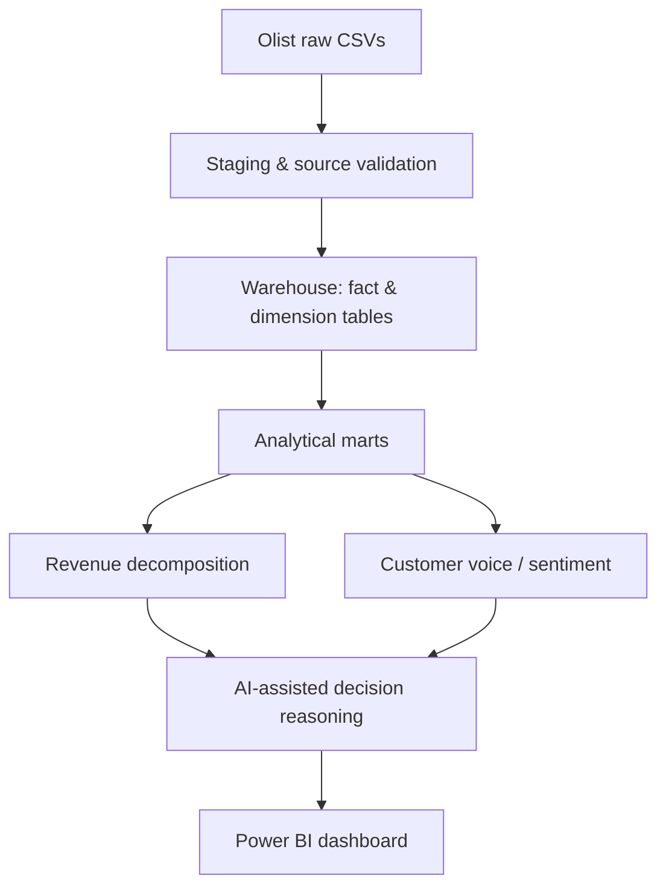

# E-Commerce Analytics Pipeline & Power BI Dashboard

End-to-end analytics engineering project on the **Olist Brazilian E-Commerce Public Dataset**. It turns nine raw CSV files into a dimensional warehouse, validated analytical marts, revenue decomposition, review sentiment analysis, AI-assisted decision reasoning, and a Power BI dashboard.


---

## Table of Contents

- [Highlights](#highlights)
- [Architecture](#architecture)
- [Key Components](#key-components)
- [Tech Stack](#tech-stack)
- [Repository Structure](#repository-structure)
- [Getting Started](#getting-started)
- [Running the Pipeline](#running-the-pipeline)
- [Dataset](#dataset)
- [Power BI Dashboard](#power-bi-dashboard)
- [Limitations](#limitations)
- [Roadmap](#roadmap)

---

## Highlights

- **Dimensional warehouse** with 3 fact tables and 7 dimension tables (about 1.5M rows in total, including a 1M-row geography dimension)
- **Data quality framework** with 44 configurable rules, severity levels, and machine-readable results
- **4 analytical marts** (customer, market, product, product-market monthly) with grain validation
- **Revenue decomposition** with a monthly bridge that reconciles to within about 1e-10
- **Customer voice analysis** of 99,224 reviews, with sentiment predictions for the 42,687 that contain text
- **AI-assisted decision reasoning** that is evidence-grounded and flagged for human review
- **539 automated tests** (pytest)

---

## Architecture



Data quality checks, automated tests, and version control apply across all stages.

---

## Key Components

### 1. Dimensional Warehouse

| Table | Rows |
|---|---:|
| `fact_order` | 99,441 |
| `fact_order_item` | 112,650 |
| `fact_payment` | 103,886 |
| `fact_review` | 99,224 |
| `dim_date` | 1,561 |
| `dim_customer` | 99,441 |
| `dim_product` | 32,951 |
| `dim_seller` | 3,095 |
| `dim_category` | 71 |
| `dim_geography` | 1,000,163 |

### 2. Data Quality

A configurable framework of **44 rules** writes its results to:

- `data/processed/quality/dq_results.csv`
- `data/processed/quality/dq_summary.json`

Latest run: 38 rules pass and 6 fail. All 6 failures are warning-level (no critical failures) and affect 2,058 records in total. They are reported rather than hidden.

### 3. Analytical Marts

| Mart | Rows |
|---|---:|
| Customer performance | 97,319 |
| Market performance | 69,722 |
| Product performance | 94,591 |
| Product-market monthly | 102,171 |

Row counts depend on each mart's defined grain.

### 4. Revenue Decomposition

A monthly bridge that explains revenue movement in interpretable components.

- 24 monthly records, with no duplicate grain
- Maximum reconciliation difference of about 9.79e-11
- September 2018 is a partial month

The reconciliation confirms the arithmetic is consistent. It does not by itself establish the business cause of each movement.

### 5. Customer Voice Analytics

Processes review text and produces sentiment predictions.

- 99,224 reviews processed
- 42,687 with text (all received a sentiment prediction)
- 56,537 without text

### 6. AI-Assisted Decision Reasoning

Uses a language-model API to generate evidence-grounded reasoning. A verified batch of 6 records is stored at `data/processed/marts/mart_llm_decision_reasoning.parquet` and passed checks for unique IDs, evidence grounding, and human-review flags.

AI output is decision support, not an approved business decision, so human review is required.

---

## Tech Stack

| Area | Tools |
|---|---|
| Language | Python 3.11 |
| Data processing | Pandas, NumPy, PyArrow |
| Storage | Parquet, CSV |
| Modeling | Staging layer, star schema, analytical marts |
| AI | Language-model API |
| BI | Microsoft Power BI |
| Testing | pytest |
| Config | YAML |

---

## Repository Structure

```
.
├── configs/       # Project and data quality configuration (YAML)
├── docs/          # Documentation and runbook (docs/RUNBOOK.md)
├── scripts/       # Pipeline entry points and validation scripts
├── src/           # Reusable project modules
├── tests/         # Automated tests
├── pyproject.toml
└── README.md
```

These folders are created locally when you run the project and are not stored in the repository: `data/raw/`, `data/processed/`, `logs/`, `outputs/`.

---

## Getting Started

**Prerequisites:** Python 3.11, Git, and Power BI Desktop (only to open the report).

```bash
git clone https://github.com/mamidikhushikareddy/E-Commerce-Analytics-Pipeline-Power-BI-Dashboard.git
cd E-Commerce-Analytics-Pipeline-Power-BI-Dashboard

conda create -n ecommerce_analytics python=3.11 -y
conda activate ecommerce_analytics

pip install -e .
```

1. Download the dataset (see [Dataset](#dataset)) and place the nine CSV files in `data/raw/`.
2. Only for the AI reasoning step, set your LLM API key as an environment variable. Check `configs/` and `docs/RUNBOOK.md` for the exact variable name.

---

## Running the Pipeline

Run the steps in this order:

```bash
python scripts/run_current_data_quality.py
python scripts/run_staging.py
python scripts/run_warehouse.py
python scripts/run_customer_performance_mart.py
python scripts/run_market_performance_mart.py
python scripts/run_product_performance_mart.py
python scripts/run_product_market_performance_monthly.py
python scripts/run_revenue_decomposition.py
python scripts/validate_revenue_decomposition.py
```

Run the tests:

```bash
python -m pytest -q
```

> **Note:** The AI reasoning workflow makes live API calls, and the Customer Voice build will not overwrite existing outputs by default. See `docs/RUNBOOK.md` before re-running either.

---

## Dataset

- **Source:** [Olist Brazilian E-Commerce Public Dataset](https://www.kaggle.com/datasets/olistbr/brazilian-ecommerce) (Kaggle)
- **Contents:** orders, customers, products, sellers, payments, reviews, and geolocation (nine CSV files)
- **Period:** approximately September 2016 to September 2018

Follow the dataset provider's license and attribution terms if you redistribute the data.

---

## Power BI Dashboard

The report file is `Product_Pulse_AI.pbix`. It is **not included in this repository** (it is untracked by Git). Add it under a `powerbi/` folder or link to it here once published.

<!-- Add dashboard screenshots here:

-->

The report opens in Power BI Desktop and refreshes successfully. Scheduled refresh and access controls have not been set up.

---

## Limitations

- Six warning-level data quality rules still fail and need investigation.
- The Customer Voice rebuild was blocked by the overwrite safeguard, so the persisted output file was not regenerated.
- The dataset is historical, not live operational data.
- AI-generated reasoning always requires human review.
- Business impact has not been measured; the use cases are decision support.

---

## Roadmap

- [ ] Provide a complete dependency manifest for one-command setup
- [ ] Investigate and document the six failing data quality rules
- [ ] Add data freshness checks and pipeline observability
- [ ] Document metric definitions and the Power BI semantic model
- [ ] Improve traceability from source evidence to reviewed AI decisions
- [ ] Add dashboard screenshots and a business case study

---

## Author

**Mamidi Khushika Reddy** · [GitHub](https://github.com/mamidikhushikareddy)
